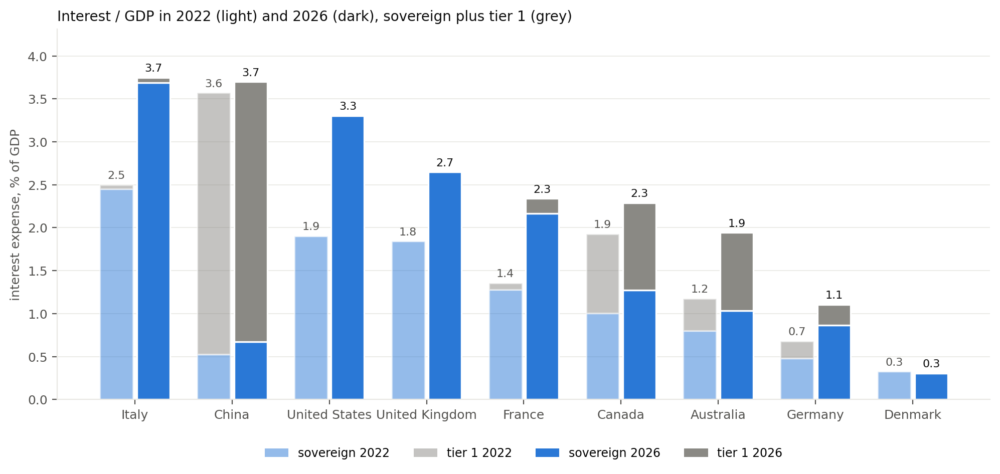
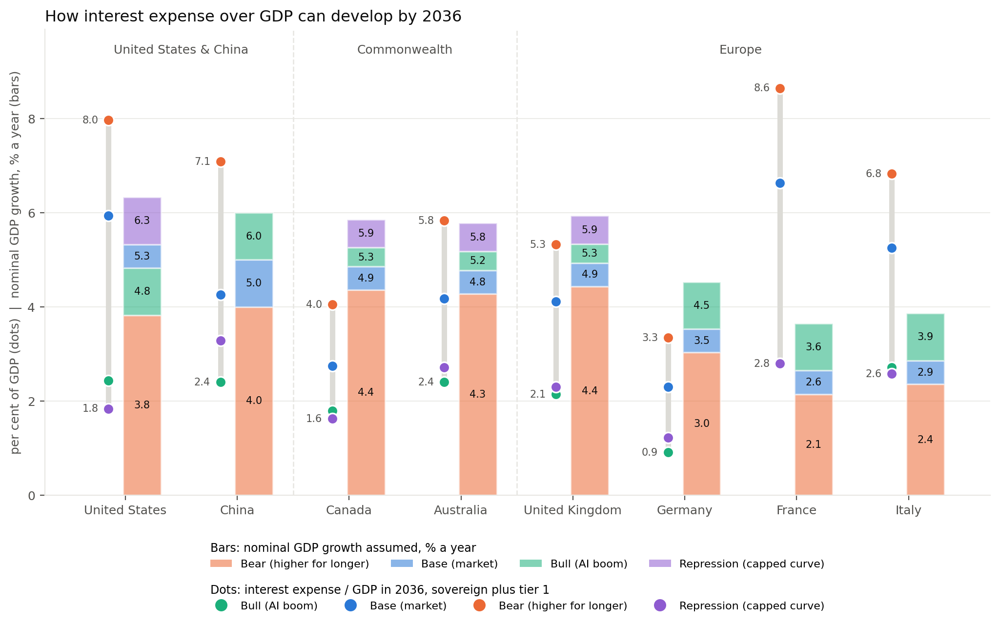
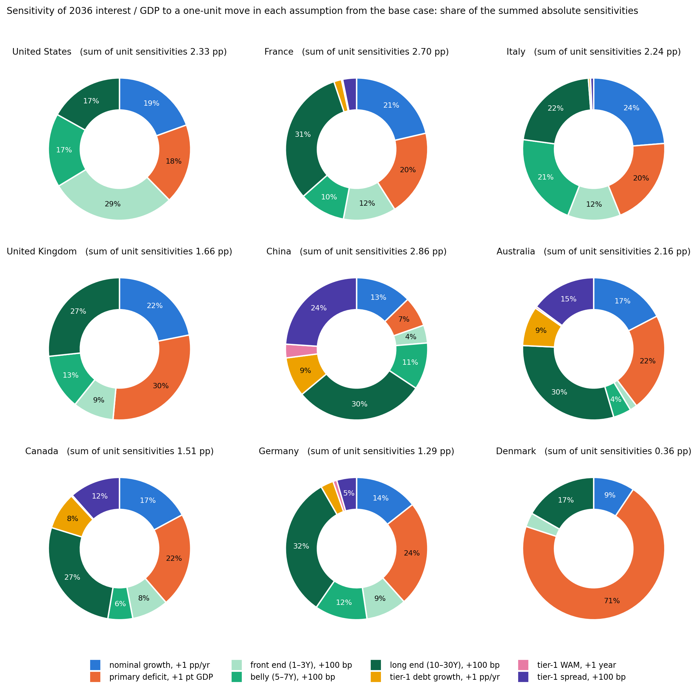
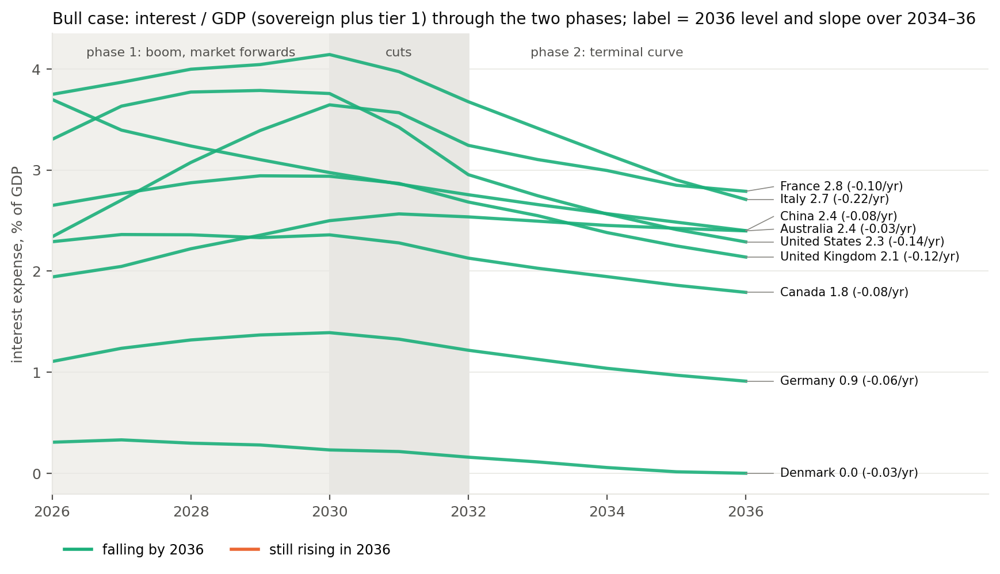

# How Will Government Interest Expense Develop Over the Next Decade?

A bond-by-bond projection of sovereign interest expense as a share of GDP for nine countries (United States, China, United Kingdom, France, Germany, Italy, Canada, Australia, Denmark) from 2026 to 2036, under four joint scenarios, with the sub-sovereign tier (provinces, states, local governments, Länder, agencies) layered on top.

The question the project asks: **given today's debt stocks, coupons, maturity profiles and market-implied yield curves, how much of GDP will governments be paying in interest by 2036, which assumptions decide the answer, and who ends up paying?**

The key deliverable is **[`outputs/Scenario_Summary.pdf`](outputs/Scenario_Summary.pdf)** (nine pages: where the burden stands today, where it can go by 2036, what it is most sensitive to, the assumptions behind each case, and sources). The longer decks and reports are listed in section 5.

---

## Contents

1. [Approach & Key Findings](#1-approach--key-findings)
   1.1 [The model in brief](#11-the-model-in-brief)
   1.2 [Country readings](#12-country-readings)
   1.3 [Two things to keep in mind when quoting the numbers](#13-two-things-to-keep-in-mind-when-quoting-the-numbers)
   1.4 [Where the burden stands today (2022 → 2026)](#14-where-the-burden-stands-today-2022--2026)
   1.5 [Where it can go by 2036](#15-where-it-can-go-by-2036)
   1.6 [What the ratio is most sensitive to](#16-what-the-ratio-is-most-sensitive-to)
   1.7 [The bull case: level and direction of travel](#17-the-bull-case-level-and-direction-of-travel)
2. [The Four Scenarios](#2-the-four-scenarios)
3. [Data](#3-data)
4. [Code & Workflow](#4-code--workflow)
5. [Outputs](#5-outputs)
6. [How to Run](#6-how-to-run)
7. [Glossary of Concepts](#7-glossary-of-concepts)
8. [References & Sources](#8-references--sources)
9. [Caveats](#9-caveats)

---

## 1. Approach & Key Findings

### 1.1 The model in brief

The model is a **cohort roll-forward** of each country's marketable central-government debt, written in Python (polars) and validated line by line against an Excel original of the US model (`model/validate_us_model.py`: all exact checks pass). Each year the government refinances the bonds that mature (from a maturity ladder measured bond by bond), borrows the primary deficit and last year's interest, and prices the new issuance at the **market-implied forward rate** for the tenors it actually issues. The average cost of the stock updates as old coupons leave and new ones arrive; interest divided by nominal GDP is the output.

Nine countries are run on October 2026 Bloomberg security-level inputs (and on 2016 inputs for a back-test). A **tier-1 overlay** adds the sub-sovereign debt national screens miss: Canadian provinces, Australian states, Chinese local-government bonds and LGFVs (bonds and loans), German Länder, French social-security agencies and Italian quasi-sovereigns. Four **joint scenarios** move growth, the primary balance, the yield curve and tier 1 together (section 2): **base** (market pricing), **bull** (an AI boom, then disinflation), **bear** (inflation persists, higher for longer) and **financial repression** (inflation of 3–4% with the curve engineered down). The evidence behind the readings in 1.2 and 1.3 follows in 1.4 to 1.7.

### 1.2 Country readings

*The numbers quoted here are from the tables and charts in 1.4 to 1.7.*

**United States.** The US is making a two-part bet: that an AI capex boom delivers, and that the proceeds are banked rather than spent. On the way there it carries the fastest-repricing stock in the sample and the only front-end-driven interest bill, which gives the Treasury the strongest incentive anywhere to have the policy rate lower. If the boom disappoints, the base case is a 6% bill and the exits are a surplus or repression, and repression in the US runs through the captive demand the dollar's reserve role supplies.

**China.** Repression has been running for years and has only held the bill flat, because the local-government stock compounds faster than the rate falls. Savers are being asked to subsidise local government indefinitely rather than through a transition. The bear case (the yield cap failing by 150 bp) is modelled as a smooth glide; administered-rate regimes do not usually fail smoothly. Because the model includes LGFV bonds and loans, its China figures are far higher than the official general-government measure, which excludes them.

**Europe.** France and Italy have the greatest *need* for financial repression and the greatest institutional *obstacle* to it: in the euro area it is an ECB decision, and it means German savers absorbing negative real returns on Bunds they did not need to issue. Germany's own base case is manageable without it. France has Italy's debt dynamics without Italy's primary surplus; its best domestic outcome (the bull) ends in the same place as the ECB repression it cannot choose. Italy's surplus stops its stock growing but cannot stop the stock repricing, which is why its path is the flattest of the high-debt three. The UK sits outside this: repression there would be a national choice, and the slowest-repricing stock in the sample buys it time.

**Canada and Australia.** The sovereigns are sound; the growth is in provinces and states that borrow long and heavily offshore, and whose backstop in 2020 was an emergency facility rather than a standing one. Tier 1 is 40–50% of their consolidated bill and Australia's states are the fastest-growing stock anywhere. A global demand shock would reach them through the long end of paper the federal government did not issue. On carrying capacity, note that interest-to-revenue cuts the other way from interest-to-GDP: broad government revenue is about 41% of GDP in Canada and 36% in Australia against 30% in the US, so the US is the stretched one on that metric, not them.

**Denmark.** The bull case retires the entire stock by 2035; even the base case shrinks it. Nothing in the model troubles Denmark; its exposure is trade, which the model does not see.

**r versus g.** Today only Italy has an average cost above nominal growth. By 2036 the baseline puts the US and France past that threshold as well. For an own-currency sovereign r > g is a chronic condition eroded through inflation and paid by savers; for Italy it is latent-acute, with mandatory surpluses, no inflation exit, and a fat tail that only the ECB's conditional backstop keeps closed. Italy is not the outlier in this study; it is the preview.

**The common thread.** Every one of the four stories resolves through the bondholder. The US asks the bondholder to wait for AI; China asks domestic savers to subsidise local government; Europe would ask German savers to subsidise France and Italy; Canada and Australia depend on foreign bondholders not leaving. The adjustment is being pushed onto creditors everywhere, and the differences between countries are about which creditors, whether they are captive, and whether they can leave.

### 1.3 Two things to keep in mind when quoting the numbers

- **These are coupon costs on marketable central-government debt, not general-government interest.** IMF and OECD general-government figures run higher: they add the accrued inflation uplift on index-linked debt (2.6% of GDP for the UK in 2022-23 alone), every level of government, and accrual items. For the US the model's 1.9% of GDP in 2022 matches CBO's net interest; the IMF's general-government figure for the same year is 3.1%. The model's definition is the one that reprices with the curve and is consistent from 2022 to 2036, but the levels will look low next to headline numbers. China is the exception in the other direction, because the model includes LGFV debt and the official measure does not.
- **Two per cent is not a historical norm.** It was the ZIRP-era norm. G7 interest bills ran at 4–5% of GDP in the 1980s and 1990s, and the base cases here are a return to that world. The 2010s were the anomaly, and every country's debt structure was built during it.

### 1.4 Where the burden stands today (2022 → 2026)



*Interest expense as a share of GDP, sovereign (blue) plus tier 1 (grey), 2022 against the model's 2026 starting point. 2022 is rebuilt on the model's own definitions from each debt office's end-2022 stock and average coupon (section 8).*

| | 2022 | 2026 | Average rate 2022 | Average rate 2026 |
|---|---|---|---|---|
| Italy | 2.5 | 3.7 | 2.1 | 3.2 |
| China | 3.6 | 3.7 | 3.9 | 3.3 |
| United States | 1.9 | 3.3 | 2.3 | 3.6 |
| United Kingdom | 1.8 | 2.7 | 2.0 | 3.1 |
| France | 1.4 | 2.3 | 1.5 | 2.3 |
| Canada | 1.9 | 2.3 | 2.7 | 3.0 |
| Australia | 1.2 | 1.9 | 2.1 | 3.4 |
| Germany | 0.7 | 1.1 | 1.2 | 1.9 |
| Denmark | 0.3 | 0.3 | 1.5 | 1.8 |

- **The rise since 2022 is almost entirely price, not quantity.** Debt ratios barely moved; average rates rose by roughly a point as 2015–21 paper rolled into today's curve. The US bill rose the most, 1.4 pt of GDP in four years, because two-thirds of its issuance is bills that reprice within a year.
- **Italy's jump is repricing, not borrowing.** Its debt/GDP was flat; about half the stock rolled over, swapping 0–1% coupons for 3.5–4.5% BTPs. The primary surplus Italy now runs only started in 2024, after two years of Superbonus-driven deficits.
- **China is the only country whose average rate fell.** Financial repression has worked on price (3.9% → 3.3%) but not on quantity: the local stock kept growing, so the bill stayed flat rather than improving.

### 1.5 Where it can go by 2036



*Dots: interest / GDP in 2036 under the four cases, sovereign plus tier 1. Bars: the nominal GDP growth assumed in each case, stacked by the extra growth each case adds over the one below it. Denmark is omitted from this chart (its bill is near zero in every case).*

**Interest / GDP in 2036, total including tier 1 (% of GDP)**

| | 2026 | Bull | Base | Bear | Repression |
|---|---|---|---|---|---|
| United States | 3.3 | 2.2 | 5.9 | 7.4 | 2.9 |
| France | 2.3 | 2.8 | 6.6 | 8.6 | 2.8 † |
| Italy | 3.8 | 2.7 | 5.3 | 6.8 | 2.6 † |
| United Kingdom | 2.7 | 2.1 | 4.1 | 5.3 | 2.3 |
| China | 3.7 | 2.4 | 4.3 | 7.1 | 3.3 |
| Australia | 1.9 | 2.4 | 4.2 | 5.8 | 2.7 |
| Canada | 2.3 | 1.8 | 2.7 | 4.0 | 1.6 |
| Germany | 1.1 | 0.9 | 2.3 | 3.3 | 1.2 † |
| Denmark | 0.3 | 0.0 | 0.3 | 0.6 | 0.2 |

† ECB-bloc case: for euro members repression is a decision taken in Frankfurt, not a national option.

- **On market pricing with today's deficits, the US goes from 3.3% to 5.9% and France from 2.3% to 6.6%.** These are the base case, not the bear, and they are mechanical: the stock still carries coupons set in the 2010s and reprices toward today's curve as it rolls, while primary deficits of 3–5% of GDP add new debt on top.
- **The bear case is where it turns ugly: 7.4% for the US and 8.6% for France.** With no cuts, the front end no longer offsets a rebuilding term premium, so the bear curve is worse than market everywhere, and the bill-heavy US programme is hit hardest.
- **Financial repression is the one case that holds the ratio near flat.** With the full easing cycle held, the long end capped and nominal growth a point higher, the US ends 2036 at 2.9%, France at 2.8% and Italy at 2.6%. It is Italy's best cell in the whole model and France's equal-best, and neither can choose it. Someone pays: a ten-year yield near 3.3% against 3.5–4% inflation is a negative real return to bondholders for a decade.
- **The UK, Canada, Australia, Germany and Denmark are manageable in every case.** Their worst outcomes in 2036 are roughly where the US and France sit today.

### 1.6 What the ratio is most sensitive to



*A like-for-like sensitivity, independent of the scenario magnitudes: each assumption is moved one unit from the base case (+1 pp/yr growth, +1 pt of GDP primary deficit, +100 bp on one segment of the curve, +1 pp/yr tier-1 growth, +1 year tier-1 WAM, +100 bp tier-1 spread) and the change in 2036 interest / GDP is recorded as the average of the up and down moves. Slices are shares of the summed absolute sensitivities.*

**Points of GDP of 2036 interest / GDP per unit move**

| | Growth +1 pp | Deficit +1 pt | Front end (1–3Y) +100 bp | Belly (5–7Y) | Long end (10–30Y) | Tier-1 growth | Tier-1 spread |
|---|---|---|---|---|---|---|---|
| United States | −0.45 | +0.42 | +0.67 | +0.39 | +0.39 | | |
| France | −0.58 | +0.53 | +0.32 | +0.28 | +0.85 | +0.05 | +0.08 |
| Italy | −0.53 | +0.45 | +0.27 | +0.48 | +0.49 | +0.01 | +0.02 |
| United Kingdom | −0.36 | +0.49 | +0.15 | +0.21 | +0.44 | | |
| China | −0.37 | +0.20 | +0.12 | +0.30 | +0.85 | +0.26 | +0.68 |
| Australia | −0.38 | +0.48 | +0.04 | +0.09 | +0.66 | +0.19 | +0.32 |
| Canada | −0.26 | +0.32 | +0.13 | +0.09 | +0.41 | +0.13 | +0.17 |
| Germany | −0.19 | +0.31 | +0.12 | +0.15 | +0.41 | +0.04 | +0.06 |
| Denmark | −0.03 | +0.26 | +0.01 | +0.00 | +0.06 | | |

- **The curve is the largest lever per unit for everyone except Denmark**, because 100 bp on a stock of 90–130% of GDP that mostly reprices within the decade is simply worth more than a point of growth or deficit. The spread between countries is the informative part: the US and France are three times as rate-sensitive as the UK per 100 bp, because the UK rolls so slowly.
- **The US is the only front-end story.** Its 1- to 3-year segment is its dominant curve exposure; every other country is a long-end story, which is where the term-premium debate actually bites.
- **A sensitivity is not a decomposition of a scenario.** The deficit is the US's weakest lever per unit, yet in the bull case it does as much work as the curve, because the bull moves the deficit by six points and the curve by about one on a ten-year average. Which assumption "mattered" depends on how far you chose to move it.
- **Tier-1 WAM is immaterial everywhere.** Lengthening the sub-national book changes when repricing happens, not whether. Tier-1 growth and spread matter where the sub-national stock is large: China, Australia, Canada.

### 1.7 The bull case: level and direction of travel



*The two-phase bull: a capex boom financed on market forwards through 2030, then cuts gliding the curve down over 2031–32 to a low terminal level. Labels give the 2036 level and the slope over 2034–36.*

| | 2026 | 2030 (end of phase 1) | 2036 | Slope 2034→36, pp/yr | Average cost 2030 → 2036 |
|---|---|---|---|---|---|
| Italy | 3.75 | 4.14 | 2.71 | −0.22 | 3.85 → 2.94 |
| United States | 3.30 | 3.76 | 2.22 | −0.15 | 4.33 → 3.04 |
| United Kingdom | 2.65 | 2.94 | 2.14 | −0.12 | 3.81 → 3.26 |
| France | 2.34 | 3.65 | 2.79 | −0.10 | 3.66 → 3.09 |
| China | 3.70 | 2.98 | 2.40 | −0.08 | 1.93 → 2.02 |
| Canada | 2.29 | 2.36 | 1.79 | −0.08 | 3.32 → 2.75 |
| Germany | 1.11 | 1.39 | 0.91 | −0.06 | 2.68 → 2.22 |
| Australia | 1.94 | 2.50 | 2.40 | −0.03 | 3.98 → 3.76 |

- **The boom alone is not enough.** The bull curve with the deficit held still leaves the US above 3% of GDP in 2036. What gets it to 2.2% is the primary balance turning to a surplus by 2030. The bet is therefore not that AI works, but that AI works *and* the revenue is used to close the deficit rather than spent, which did not happen after 2001.
- **Phase 1 is expensive.** The US and France add 1–1.7 pt of GDP of interest by 2030 financing a boom at today's curve before any relief arrives. France is the only country whose bull level in 2036 sits a full point above today.
- **Repricing speed and budget position pull in different directions.** The US average cost collapses from 4.3% to 3.0% because it rolls fast; the UK's only drifts from 3.8% to 3.3%. But the ratio's slope is set by the budget too: Italy, with a surplus and the largest cost drop in Europe, is the steepest faller; Australia is flat because its states keep borrowing through the cuts.

---

## 2. The Four Scenarios

Every number is defined relative to each country's own starting point. Full per-country tables are the last pages of `outputs/Scenario_Summary.pdf`.

| | Nominal growth | Primary balance | Yield curve | Tier 1 |
|---|---|---|---|---|
| **Base** (market) | Average of the 2016–25 CAGR and the latest year | Held at today's level | Market-implied forwards from today's curve | Middle historical growth pace, current WAM, through-cycle spread |
| **Bull** (AI boom, then disinflation) | 2027–30: base +1.0. From 2031: back to base for the US, UK, Canada, Australia; base +1.0 for euro members, Denmark, China | Glides from today to a surplus of at least 1% of GDP by 2030 (1.5 pt better where already in surplus), then held | 2027–30 on market forwards; glides over 2031–32 to a low terminal curve (US 2.0 / 2.2 / 3.0 / 3.5 at 1, 2, 10, 30 years; France's spread over Bunds tightened to ~100 bp) and held | Middle pace; the longer WAM and tight spread phased in over 2031–32 |
| **Bear** (inflation persists, higher for longer) | Base −0.5 | 1.5 pt of GDP worse by 2036 | No cuts: front end +25 bp over market; term premium rebuilds with the fiscal position (30-year +110 bp high-debt, +65 bp low-debt; France +50, Italy +75 bp of spread from 10 years out); reached by 2028 and held as a spread over market forwards | Fastest historical pace, shorter WAM, stressed spread |
| **Repression** (inflation 3–4%, curve capped) | Base +1.0 (inflation, not real growth) | Held (repression substitutes for consolidation) | Full easing cycle held for the decade; long end capped with the term premium near zero (10-year ≈ 1-year + 1.3); reached by 2028 and held as a level. An ECB-bloc case for Germany, France, Italy; shallower cap for Australia | Middle pace, longer WAM, tight spread (captive banks absorb it) |

**China** is handled on its own terms: growth 6 / 5 / 4 / 5% (bull / base / bear / repression); bull and repression are the yield cap holding (market forwards), base is a developed-market steepening of its administered curve (long end +0.75 to +1 pt), bear is the cap failing (parallel +1.5 pt). Its tier 1 includes LGFV bank and trust loans (~RMB 42tn), which no securities screen captures; LGFV bonds and loans retire as the swap replaces them with local-government bonds, so swapped debt is not counted twice.

Repression is a **joint** scenario and is never crossed with the other levers. The 27-cell lever grid (growth low/base/high × deficit improves/holds/worsens × curve bull/market/bear) is kept for the sovereign-only report and the sensitivity analysis.

---

## 3. Data

| Input | Source | Where in the repo |
|---|---|---|
| Bond-level stock, coupons, maturities (every live central-government bond and bill, 2026 and 2016 snapshots) | Bloomberg SRCH pulls, dated 16 Oct 2026; 2016 pulls dated 30 Sep 2016 (US), 31 Mar 2016 (UK, Canada), 30 Jun 2016 (Australia), end-2016 (others). Issue dates estimated from market conventions and identifier order. | Processed into `data/inputs/<vintage>/<CC>_debt_inputs.csv` (one long-format file per country with per-line notes). The raw pulls are licensed and are **not** in the repository. |
| On-the-run yield curves, short-end points, China / Denmark / Australia curves | Bloomberg yields file (16 Oct 2026); policy rates and 1-year bills from central banks and debt offices (mid-Oct 2026); ChinaBond CGB curve (20 Oct 2026); Danish and Australian quotes (15–19 Oct 2026) | `data/inputs/2026/*.csv`, `spot_curve` section |
| 2016 spot curves | Author's table (overnight, 2y, 5y, 10y, long bond) | `data/inputs/2016/*.csv` |
| Term premia (5y, 10y; 2016 and 2026) | OIS decomposition workbook (US, Canada, UK); euro members and Denmark = EUR OIS term premium + Bund swap spread + 10-year sovereign spread versus Bunds (Eurostat convergence yields Dec 2016; market quotes Oct 2026); Australia set equal to Canada; China a judgment estimate | `data/inputs/*/*.csv`, `implied_tp` and `static_tp` sections |
| General-government fiscal balances | IMF World Economic Outlook, October 2026 (UK 2026 from the April 2026 Fiscal Monitor; US and UK 2016 via FRED) | `data/inputs/*/*.csv`, `history` section |
| Nominal GDP, local currency | World Bank WDI, GDP current LCU (NY.GDP.MKTP.CN) | `data/inputs/*/*.csv`, `history` section |
| Sub-sovereign stocks, balances, WAM, spreads (2016–2026) | Canadian provincial financing authorities (ON, QC, AB, BC); Australian state treasury corporations (NSW TCorp, TCV, QTC, WATC); Chinese MoF local-government bond data and LGFV bond buckets by rating; German Länder debt statistics; CADES, Unédic, ACOSS (plus SFIL/CAFFIL, Bpifrance, AFL, IDFM as exposure variants); Italian CDP, FS, regional sinkers, CDP postal savings | `data/tier1/*.csv`, method in `data/tier1/tier1_model_notes.pdf` |
| 2022 sovereign stocks and average coupons (for the then-versus-now chart) | US Treasury (MSPD and average interest rates, Dec 2022); Finance Canada Debt Management Report 2022-23; UK DMO portfolio statistics with ONS/OBR debt interest net of RPI uplift; AFT and Cour des comptes; Italian MEF Rapporto sul debito pubblico 2022; Finanzagentur Kreditaufnahmebericht 2022; Danmarks Nationalbank Central government borrowing and debt 2022; AOFM Annual Report 2021-22; Chinese MoF 2022 central final accounts | Hardcoded with sources in `model/then_vs_now.py`; written to `outputs/2026/INTEREST_THEN_VS_NOW.csv` |
| US reference model | `US_Debt_Model_v4.xlsx` and its input file, used only to validate the engine | `data/reference/` |

---

## 4. Code & Workflow

```
Sovereign-Interest-Expense-Scenarios/
├── README.md
├── requirements.txt
├── model/
│   ├── debt_model.py          the engine: curve machinery, input loader, cohort roll-forward, scenario grid
│   ├── build_inputs.py        Bloomberg pulls -> data/inputs/*.csv (needs the raw pulls; provenance only)
│   ├── run_scenarios.py       scenario definitions (joint cases, curve tables, China rules) and the country x vintage runs
│   ├── tier1_overlay.py       sub-sovereign blocks: growth / WAM / spread settings, consolidated paths
│   ├── scenario_lines.py      the two decks (Scenario_Summary.pdf, Scenario_Lines.pdf) and their CSVs
│   ├── then_vs_now.py         the 2022-against-2026 chart (imported by scenario_lines.py)
│   ├── make_report.py         Debt_Service_Report.pdf: sovereign-only lever grid, country pages, r vs g, 2016 back-test
│   ├── make_tier1_report.py   Tier1_Overlay_Report.pdf
│   ├── validate_us_model.py   engine-versus-workbook proof
│   └── run_all.py             runs the chain in order
├── data/
│   ├── inputs/2026/           nine model input files (long format: section,item,sub_item,period,value,notes)
│   ├── inputs/2016/           the 2016 vintage for the back-test
│   ├── tier1/                 six sub-sovereign files + method notes
│   └── reference/             the US workbook and its input file (validation only)
└── outputs/
    ├── Scenario_Summary.pdf   <- start here
    ├── Scenario_Lines.pdf, Debt_Service_Report.pdf, Tier1_Overlay_Report.pdf, Interest_Then_vs_Now.pdf
    ├── figures/               every chart as PNG
    ├── 2026/                  results: ALL_interest_to_gdp, ALL_detail_paths, ALL_assumptions, SCENARIO_*, TIER1_assumptions,
    │                          CONSOLIDATED_paths, INTEREST_THEN_VS_NOW
    └── 2016/                  back-test results
```

**Workflow.** `run_scenarios.py` resolves each country's assumptions relative to its own inputs and runs the 27-cell lever grid plus the joint repression cell for both vintages. `tier1_overlay.py` rolls each sub-sovereign block forward under the joint cases and re-runs the sovereign on a central-only balance. `scenario_lines.py` builds the joint bull / base / bear / repression paths (sovereign plus tier 1), the sensitivity analysis and both decks, importing the 2022 comparison from `then_vs_now.py`. The two report scripts produce the longer PDFs. Every chart is regenerated on each run, so the decks always reflect the current settings.

**Settings live at the top of the scripts, not in the data.** Scenario curves, growth and deficit rules are constants in `run_scenarios.py` (`CURVES_2028`, `BULL_TERMINAL`, `GROWTH_DELTA`, `BULL_SURPLUS`, China rules); tier-1 settings in `tier1_overlay.py` (`T1_CASE`, `WAM_MULT`, `COST0`, `BLOCKS`); the engine's own defaults in the USER SETTINGS block of `debt_model.py`. Input files contain data only.

---

## 5. Outputs

| File | What it is |
|---|---|
| **`outputs/Scenario_Summary.pdf`** | The nine-page summary: 2022 → 2026, the 2036 range chart, sensitivity pies, one assumptions page per case, sources. |
| `outputs/Scenario_Lines.pdf` | The full deck: stacked bars per case (2026 vs 2036, tier 1 stacked), growth assumptions, growth-minus-interest charts, sensitivity table by tenor, CAGR table, bull-case direction of travel, assumptions, sources. |
| `outputs/Debt_Service_Report.pdf` | Sovereign-only report on the lever grid: headline table, methodology, cross-country structure charts, a page per country, the r-versus-g Italy case study, the 2016 → 2026 back-test, caveats. |
| `outputs/Tier1_Overlay_Report.pdf` | The sub-sovereign overlay: how much tier 1 adds, the explicit assumptions per block, what drives the add, country notes, exposure variants. |
| `outputs/Interest_Then_vs_Now.pdf` | Standalone copy of the 2022-against-2026 page. |
| `outputs/2026/SCENARIO_LINES.csv` | Year-by-year path of every joint case per country: sovereign and tier-1 interest / GDP, debt / GDP, average costs. |
| `outputs/2026/SCENARIO_ASSUMPTIONS.csv` | The resolved assumptions behind each case per country (growth, balance, curve points in 2028 and 2036, tier-1 settings). |
| `outputs/2026/SCENARIO_SENSITIVITY.csv` | Unit sensitivities by lever and tenor. |
| `outputs/2026/ALL_interest_to_gdp.csv`, `ALL_detail_paths.csv`, `ALL_assumptions.csv` | The sovereign-only lever grid: one row per scenario cell, the full yearly detail, and every resolved path. |
| `outputs/2026/TIER1_assumptions.csv`, `CONSOLIDATED_paths.csv` | Tier-1 block settings per case and the consolidated sovereign-plus-tier-1 paths. |
| `outputs/2026/INTEREST_THEN_VS_NOW.csv` | The 2022 and 2026 figures with their sources. |
| `outputs/2016/` | The back-test vintage. |

---

## 6. How to Run

```bash
git clone <this repository>
cd Sovereign-Interest-Expense-Scenarios
python -m venv .venv && source .venv/bin/activate
pip install -r requirements.txt

python model/run_all.py              # rebuilds every CSV, chart and PDF under outputs/
python model/run_all.py --validate   # also re-runs the engine-versus-workbook validation first
```

Individual steps can be run on their own from `model/` (`python run_scenarios.py`, `python scenario_lines.py`, ...). To change a scenario, edit the constants at the top of `model/run_scenarios.py` or `model/tier1_overlay.py` and rerun. To add a country, add a `data/inputs/2026/<CC>_debt_inputs.csv` in the same long format (the engine reads any file with the documented sections) and append the code to the country lists at the top of the scripts. `build_inputs.py` is included for provenance; it needs the Bloomberg pulls in `data/bloomberg/`, which are not redistributed.

Requires Python 3.11+ and the packages in `requirements.txt` (polars, matplotlib, reportlab, openpyxl, pypdf).

---

## 7. Glossary of Concepts

- **Interest / GDP.** Interest expense on the modelled debt divided by nominal GDP. Here: average cost × average debt over the year, on marketable central-government securities plus the tier-1 blocks. Not the same as general-government interest in national accounts (section 1.3).
- **Primary balance / primary deficit.** The budget balance before interest. The model uses the IMF general-government balance less its own modelled interest; where tier 1 exists it removes the sub-national sector's own balance to get a central-only figure. Sign convention in the files: + = deficit.
- **Average cost of the stock.** Coupon-weighted average interest rate on the outstanding debt (bills at the 1-year rate). It moves only as debt matures and is replaced, which is why structure sets the speed of repricing.
- **Market-implied forward rate.** The rate at which a tenor can be issued in a future year, implied by today's spot curve: f(h, m) = [y(h+m)(h+m) − y(h)h] / m, with the term premium embedded today stripped out and a static premium added back. The base case prices every future issue this way.
- **Term premium.** The part of a long yield that compensates for holding duration rather than expected short rates. European premia here include each country's sovereign spread over Bunds.
- **Cohort roll-forward.** The engine's method: each year's issuance is tracked as a cohort with its own rate and maturity; when it matures it is refinanced at that year's forward rate for the tenor the country actually issues.
- **Maturity ladder.** The amount and average coupon of existing bonds maturing in each future year, measured from the bond-level pull.
- **Issuance composition.** The share of gross issuance by tenor (bills, 2y, 3y, 5y, 7y, 10y, 20y, 30y), estimated from the lines opened in the last two years. Bills reprice within a year; a 30-year locks a coupon for three decades.
- **WAM.** Weighted average remaining maturity of a debt stock. A short WAM means rate changes reach the average cost quickly; "repricing within three years" is the share of today's stock that matures by 2029.
- **Tier 1.** The sub-sovereign and quasi-sovereign debt that national bond screens omit but that the public sector services: provinces, states, local-government bonds, LGFVs, Länder, social-security agencies. Modelled as blocks with a growth rate, a WAM and a spread over the sovereign curve.
- **LGFV.** Local Government Financing Vehicle: Chinese off-budget borrowers for local infrastructure, funded by bonds and bank and trust loans, being partly refinanced into local-government bonds through a debt swap.
- **Joint scenario versus lever grid.** A joint scenario moves growth, the balance, the curve and tier 1 together as one story (bull, base, bear, repression). The lever grid moves one assumption at a time with the others at base, and is what the sensitivity analysis uses.
- **Key-rate (segment) sensitivity.** The effect of +100 bp on one part of the curve only, fading linearly to the neighbouring tenors; the front (1–3y), belly (5–7y) and long (10–30y) segments add up to a parallel shift.
- **Financial repression.** Holding nominal rates below inflation for an extended period, typically with captive domestic buyers (banks, pension funds, the central bank), so that the real value of debt erodes at bondholders' expense. The repression case holds the policy rate down and caps the long end for a decade.
- **ECB-bloc case.** A scenario a euro member cannot choose on its own because it requires the ECB to act for the whole currency area. Repression for France, Italy and Germany is flagged this way throughout.
- **r versus g.** The average interest rate on debt against nominal growth. With r > g a primary surplus is needed just to hold debt / GDP flat, and the required surplus scales with the debt ratio.
- **Index-linked uplift.** The inflation compensation accrued on inflation-linked bonds, booked as interest in national accounts but not a coupon. Large in 2022; excluded from the model's coupon-based measure.
- **Spread over market / held as a level.** How a scenario curve is carried after it is fully in place: the bear keeps its shift over the market forward path (so "no cuts, +25 bp over market" stays true all decade); repression and the bull terminal are held at fixed levels, as a cap would be.

---

## 8. References & Sources

**Market and bond data**
- Bloomberg L.P., SRCH security screens of central-government bonds and bills (16 Oct 2026 and 2016 snapshots) and on-the-run yield curves (16 Oct 2026). Licensed; not redistributed.
- ChinaBond, CGB yield curve, 20 Oct 2026.
- Central banks and debt offices for policy rates and 1-year bill yields, mid-October 2026 (Federal Reserve, Bank of Canada, Bank of England, ECB, Danmarks Nationalbank, Reserve Bank of Australia, People's Bank of China).
- Eurostat, EMU convergence criteria series (10-year yields, December 2016) for the 2016 sovereign spreads.

**Macro and fiscal**
- International Monetary Fund, *World Economic Outlook* database, October 2026, and *Fiscal Monitor*, April 2026 (general-government net lending/borrowing, primary balance, gross debt). IMF DataMapper series `ie` (interest paid on public debt, % of GDP) used for the general-government comparison in section 1.3.
- World Bank, *World Development Indicators*, GDP (current LCU), NY.GDP.MKTP.CN.
- Federal Reserve Bank of St. Louis, FRED (IMF WEO series for US and UK 2016 balances).

**2022 sovereign stocks and average rates**
- US Department of the Treasury, Fiscal Data: *Monthly Statement of the Public Debt* and *Average Interest Rates on U.S. Treasury Securities*, December 2022.
- Department of Finance Canada, *Debt Management Report 2022–2023*.
- UK Debt Management Office, *Quarterly Review January–March 2023* and *Annual Review 2022–23*; Office for National Statistics, *Public sector finances* (central-government debt interest); Office for Budget Responsibility on the RPI uplift on index-linked gilts.
- Agence France Trésor, *Rapport d'activité 2022* and monthly bulletins; Cour des comptes, *Le budget de l'État en 2022* and *Note d'exécution budgétaire 2022, Engagements financiers de l'État*; Sénat, rapport sur le projet de loi de règlement 2022.
- Ministero dell'Economia e delle Finanze, *Rapporto sul debito pubblico 2022* and *Public Debt Report 2023*.
- Bundesrepublik Deutschland Finanzagentur, *Kreditaufnahmebericht des Bundes 2022*; Institut der deutschen Wirtschaft on the average rate of federal debt.
- Danmarks Nationalbank, *Central government borrowing and debt 2022*.
- Australian Office of Financial Management, *Annual Report 2021–22*.
- Ministry of Finance of the People's Republic of China, 2022 central government final accounts (国债余额, 债务付息支出).

**Sub-sovereign**
- Ontario Financing Authority, Ministère des Finances du Québec, Alberta Treasury Board and Finance, BC Ministry of Finance (debt, balances, effective interest rates); Financial Accountability Office of Ontario, interprovincial comparisons.
- NSW Treasury Corporation, Treasury Corporation of Victoria, Queensland Treasury Corporation, Western Australian Treasury Corporation, annual reports.
- Chinese Ministry of Finance, *China Local Government Bond Market Reports*; LGFV bond data by rating bucket.
- Deutsche Bundesbank, *Länderfinanzen* and Länder debt statistics.
- CADES, Unédic and ACOSS annual and financial reports; Cassa Depositi e Prestiti and Ferrovie dello Stato disclosures.

**Model**
- `US_Debt_Model_v4.xlsx`, the original US workbook the engine reproduces (`data/reference/`).

---

## 9. Caveats

- **Definition.** The model measures the coupon bill on marketable central-government debt plus the defined tier-1 blocks. It understates the all-in public-sector burden by the inflation uplift on linkers (large in 2022, small now) and by sub-national debt outside tier 1 (0.3–0.5 pt of GDP for the US and Canada), and overstates it relative to official Chinese figures by including LGFVs.
- **No feedback.** Growth, the primary balance and the curve are separate levers with no endogenous link. In reality a bear curve arrives because of the deficit, and a boom changes the deficit. The joint scenarios make the correlations explicit by assumption; the lever grid holds everything else fixed.
- **No buyers' strike.** The model prices paths, not the event that ends them. Bear outcomes assume the market keeps funding the deficit at the bear curve.
- **Estimated issue dates and issuance composition.** The Bloomberg pulls carry no issue dates; they are inferred from identifiers and conventions, anchored on the 2016 pull. The composition is held constant over the horizon.
- **Scenario levels are judgments.** The bull terminal curve, the bear term-premium rebuild, the repression cap and the tier-1 settings are author-specified. The 2016 → 2026 back-test in `Debt_Service_Report.pdf` shows that market forwards under-predicted every bill but Denmark's and China's, which is the case for treating the base case as a central estimate conditional on the curve, not a forecast of the curve.
- **Tier-1 starting costs and 2022 effective rates** carry roughly ±0.3 pt of uncertainty; several 2022 tier-1 rates are estimates and are marked as such in the sources.
- **Italian floaters** (CCTeu, 4% of issuance) are priced at pure overnight expectations without Italy's spread; the effect on the bill is a few basis points.

---

*Mikkel Borggren, Yale School of Management, 2026. Model built in Python with polars, matplotlib and reportlab.*
